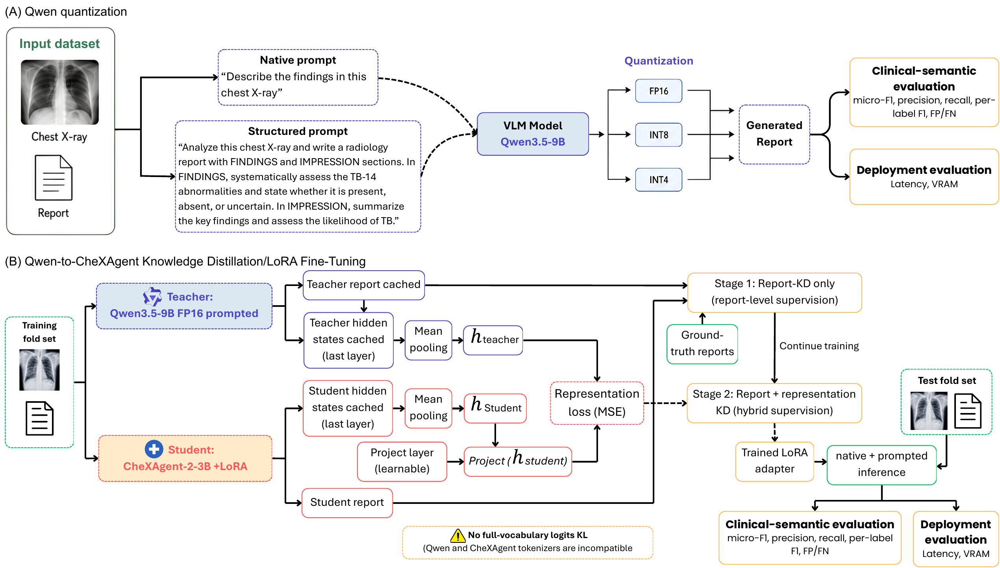

# Accelerating Chest X-ray Report Generation for Tuberculosis Screening in Indonesia: An Efficiency-Aware Benchmark of Quantized and Distilled Vision-Language Models

This repository is the research-code and pipeline-level reproducibility package for the EMA MICCAI 2026 paper above. The repository name is shortened for readability, but the full paper title is used here as the authoritative title.

> Reproducibility scope: the public repository supports code-level and pipeline-level reproduction. Full numerical reproduction requires access to the institutional chest X-ray-report dataset, patient split definitions, case-level outputs, and local checkpoints, which are not publicly released.

The project benchmarks a Qwen3.5-9B multimodal vision-language teacher under FP16, INT8, and INT4 inference and distils report-level and representation-level supervision to a CheXAgent student. It evaluates automated TB-14 label agreement together with latency and allocated VRAM.

## Model identity

The teacher model used for the Qwen experiments is `Qwen3.5-9B` with a 9B-parameter model family, loaded from the official Hugging Face repository as `Qwen/Qwen3.5-9B` and mirrored locally as `qwen3.5-9b` for the paper runs. The exact snapshot revision was not recoverable from the local copy. This is a multimodal Qwen vision-language model and should not be described as the historical `Qwen-VL` model. The Qwen teacher was selected for distillation because it achieved the strongest prompted micro-F1 among the candidate VLM baselines reported in the aggregate results.

## Data source and institutional collaboration

The study used de-identified chest X-ray/report pairs from Cipto Mangunkusumo Hospital (RSCM), accessed through BDC IMERI Idealab. The underlying clinical records are not distributed through this repository.

## What is included

- Qwen FP16/INT8/INT4 inference code.
- CheXAgent report-plus-representation knowledge-distillation code.
- Data-cleaning, X-Raydar preparation/scoring, TB-14 evaluation, bootstrap, and figure-generation code.
- Portable configuration templates and privacy-preserving documentation.
- Model source links and experiment configuration templates.
- The study-produced CheXAgent LoRA adapter artefacts used for the report-plus-representation KD experiment.
- Synthetic format examples and two de-identified public CXR/report examples for input-shape testing.

## What is not included

- The institutional CXR-report dataset, DICOM files, raw reports, and patient-level metadata.
- Per-case predictions, evaluation files, scheduler logs, model caches, merged checkpoints, or full base-model checkpoints.
- Third-party model weights and the external X-Raydar NLP source code.

See [data/README.md](data/README.md) for the data policy and [models/README.md](models/README.md) for model and weight handling.

## Model weights

The original base-model weights are available from their respective official repositories, as listed in [models/README.md](models/README.md). This repository does not redistribute third-party model weights.

The report-plus-representation KD LoRA adapter artefacts are included under [models/adapters/qwen_fp16_report_reprkd_prompted_l4_epoch1](models/adapters/qwen_fp16_report_reprkd_prompted_l4_epoch1). The merged CheXAgent checkpoint and any full distilled student/base-model checkpoints are not included. Any future release of merged or full checkpoints would require separate approval under the applicable institutional, licensing, and data-governance requirements.

## Repository structure

~~~text
.
|-- configs/        # Path templates and public experiment metadata
|-- data/           # Data availability statement and synthetic CSV examples
|-- docs/           # Reproducibility guide and release documentation
|-- environments/   # Conda environment exports
|-- models/         # Model identifiers, source links, adapter artefacts, and weight policy
|-- results/        # Aggregate, non-identifiable tables from the paper
`-- src/            # Inference, distillation, evaluation, and analysis code
    |-- analysis/
    |-- distillation/
    |-- evaluation/
    `-- quantization/
~~~

The released entry points are under `src/`. Prompt templates used by the Qwen experiments are embedded in `src/quantization/infer_qwen_quantized.py`; there is no separate `prompts/` or `scripts/` directory in this release.

## Quick start

The commands below show the shape of a local run. They require approved local data, model checkpoints, and an external X-Raydar checkout; synthetic examples are provided only to document CSV structure.

~~~bash
conda env create -f environments/qwen.yml
conda activate qwen
cp configs/paths.example.env .env
python src/quantization/infer_qwen_quantized.py --mode int4 --input-csv /path/to/approved_metadata.csv --dicom-root /path/to/approved_dicom_root --model-path /path/to/qwen3.5-9b --output-dir /path/to/local_outputs/qwen --output-name qwen_int4_fold0 --fold-ids-txt /path/to/fold0_ids.txt --fold-id 0 --prompt-modes native prompted --max-new-tokens 256
python src/evaluation/prepare_xraydar_input.py --input-csv /path/to/local_outputs/qwen/qwen_int4_fold0.csv --output-csv /path/to/local_outputs/qwen/qwen_int4_fold0_for_xraydar.csv
python src/evaluation/score_with_xraydar.py --input-csv /path/to/local_outputs/qwen/qwen_int4_fold0_for_xraydar.csv --output-csv /path/to/local_outputs/qwen/qwen_int4_fold0_xraydar_scores.csv --repo-dir /path/to/xraydar/src
python src/evaluation/evaluate_tb14.py --input-csv /path/to/local_outputs/qwen/qwen_int4_fold0.csv --vlm-nlp-csv /path/to/local_outputs/qwen/qwen_int4_fold0_xraydar_scores.csv --output-dir /path/to/local_outputs/qwen/eval_tb14
~~~

The Qwen FP16 run reported about 19 GB allocated VRAM on an NVIDIA L4, while INT4 reported about 9 GB. Full commands, inputs, outputs, and validation checks are documented in [docs/reproducibility.md](docs/reproducibility.md).

## Paper workflow

The paper workflow is organised as follows:

1. Baseline inference: run candidate VLMs on the same approved fold and prompt settings to produce model-level aggregate baselines.
2. Qwen precision comparison: run the verified Qwen3.5-9B teacher under FP16, INT8, and INT4 for native and structured-prompted inference.
3. Teacher-output generation: save teacher reports and teacher representations locally for approved training cases.
4. Report-only KD: train a CheXAgent LoRA student using reference reports and Qwen-generated reports.
5. Report-plus-representation KD: continue/adapt the CheXAgent student using report supervision plus teacher representation alignment.
6. TB-14 evaluation: score reference and generated reports with the automated X-Raydar/RoBERTa label pipeline and compute label agreement.
7. Latency and VRAM measurement: record per-report latency and peak allocated/reserved GPU memory during inference.
8. Paper tables and figures: recreate aggregate tables in `results/tables/` and analysis outputs from non-identifiable local summaries.

Case-level predictions, split files, raw scheduler logs, DICOM paths, and patient identifiers are intentionally excluded from the public repository.

## Evaluation protocol

The automated evaluation uses the TB-14 thoracic finding set:

- infiltration
- apical changes
- cardiomegaly
- pleural effusion
- hilar enlargement
- pleural abnormality
- consolidation
- cavity
- fibrosis
- atelectasis
- bronchial changes
- bulla
- pneumothorax
- mediastinum displaced

The original radiology reports are in Indonesian. In the paper workflow, reference reports were translated/prepared into English before automated X-Raydar/TB-14 label extraction. The released evaluation script does not perform translation itself; it consumes the preprocessed reference text and precomputed reference labels supplied in the approved local metadata. This preprocessing step may introduce translation-related or language-dependent label noise. Prediction labels are produced by first exporting generated reports with `src/evaluation/prepare_xraydar_input.py`, then scoring them with `src/evaluation/score_with_xraydar.py`.

`src/evaluation/evaluate_tb14.py` maps X-Raydar columns to the TB-14 labels, applies a 0.5 threshold, and reports semantic micro-precision, micro-recall, micro-F1, macro-F1, micro-accuracy, per-label precision/recall/F1, and lexical BLEU/ROUGE summaries. `src/analysis/compute_bootstrap_micro_f1_ci.py` computes bootstrap confidence intervals for micro-F1 from local per-sample outputs.

Latency is measured per generated report after model loading, with CUDA synchronisation around generation. The script resets CUDA peak memory statistics before each case and records `peak_gpu_mem_allocated_gb` and `peak_gpu_mem_reserved_gb`; reported aggregate tables use allocated VRAM. Qwen inference is performed one image at a time in the released script, while X-Raydar scoring uses batched text inference with configurable `--batch-size` and default 16.

## Tested environment

The exported Qwen environment used for the released workflow records the following core setup:

- OS: Linux GPU environment.
- Python: 3.10.20.
- PyTorch: 2.7.1+cu118.
- CUDA runtime packages: cu118.
- Transformers: 5.8.0.
- PEFT: 0.18.1.
- Quantization: bitsandbytes 0.49.2; FP16, INT8, and INT4 inference paths.
- GPU: NVIDIA L4 for reported latency and allocated-VRAM measurements.

## Limitations

- The dataset is single-centre and comes from RSCM/BDC IMERI Idealab; no independent external validation set is released.
- The public repository does not include the institutional dataset, patient split definitions, case-level predictions, or checkpoints, so full numerical reproduction is not possible from public files alone.
- TB-14 evaluation is an automated semantic proxy, not radiologist-adjudicated ground truth.
- The automated label-extraction workflow may introduce language-dependent noise because the source reports are Indonesian and the NLP labeler may not be optimised for Indonesian radiology text.
- Latency and allocated-VRAM measurements are hardware-, driver-, CUDA-, and library-version dependent.
- FP8 inference was not evaluated in the reported experiments.
- The work supports retrospective benchmarking and method comparison; it does not establish clinical readiness or external generalisability.

## Clinical-use statement

This research is for retrospective benchmarking and human-verifiable reporting support. It is **not** an autonomous diagnostic system and must not be used for clinical decision-making without appropriate prospective validation, local governance approval, and clinician oversight.

## Ethics and privacy

This repository does not contain patient data, clinical images, raw radiology reports, patient identifiers, case-level predictions, split manifests, or institutional paths. Do not upload or transmit clinical data through GitHub Issues, pull requests, discussions, repository releases, or other public repository features.

The study protocol was reviewed and approved by the Health Research Ethics Committee of the Faculty of Medicine, Universitas Indonesia - Cipto Mangunkusumo Hospital (ethical approval no. KET-68/UN2.F1/ETIK/PPM.00.02/2026; protocol no. 25-11-1726; approved 16 January 2026).

Local users are responsible for ensuring that any use of institutional or clinical data complies with the applicable ethics approval, data-use agreement, institutional governance, privacy requirements, and model-provider terms. The institutional dataset is not distributed in this repository and is not covered by the repository licence.

## Licence and citation

Repository reuse is governed by the MIT licence in [LICENSE](LICENSE), matching the CheXAgent student/base-model licence. Third-party models, datasets, and software retain their own licences and terms; in particular, the Qwen teacher model is distributed by its provider under Apache-2.0. The institutional dataset is excluded from the repository licence.

Please cite the EMA MICCAI 2026 paper when using this repository. Preliminary machine-readable citation metadata is provided in [CITATION.cff](CITATION.cff); final DOI and Springer metadata should be updated after publication.

## Acknowledgements

This work was supported through the LEINA project ("Low-Compute Vision-Language Model for Equitable Tuberculosis Detection in Indonesian Chest X-Rays"), funded by the MICCAI Society under its 2026 Project on Climate and Environmental Health.
